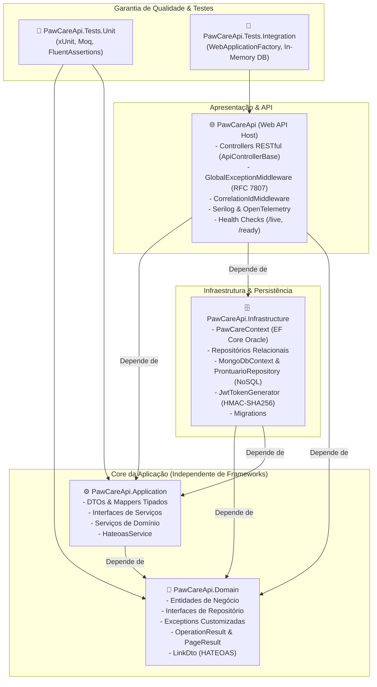

# 🐾 PawCare API - Gestão Veterinária & Cuidados Pet
> **Advanced Business Development with .NET - FIAP 2026**  
> *Consolidação Final - 4ª Sprint*

---

## 👥 Integrantes do Grupo

| Nome | RM |
|---|---|
| **Thomas Fontes** | **562254** |
| **Matheus Molina** | **563399** |
| **Gabriel Maciel** | **562795** |
| **Vitória Rodrigues** | **565160** |
| **Augusto Bonomo** | **565155** |

🔗 **Repositório GitHub:** [https://github.com/thomasmfontes/PawCare.NET](https://github.com/thomasmfontes/PawCare.NET)

---

## 📌 1. Visão Geral da Solução

O **PawCare API** é uma solução backend corporativa desenvolvida em **.NET 10** (C#) aplicando os padrões arquiteturais mais modernos da indústria de software: **Clean Architecture**, **Repository Pattern**, **Operation Result**, **PageResult**, **HATEOAS**, persistência híbrida (**Oracle Database Relacional** via Entity Framework Core e **MongoDB NoSQL** com MongoDB.Driver), **Segurança JWT Bearer**, **Observabilidade completa (Serilog, OpenTelemetry e Health Checks)** e uma abrangente suíte de **44 testes automatizados (xUnit)**.

A plataforma centraliza a gestão de cuidados veterinários, permitindo o acompanhamento de pets, tutores, clínicas, raças, tratamentos, médicos veterinários, eventos clínicos e o armazenamento semiestruturado de **prontuários veterinários eletrônicos NoSQL**.

---

## 🏗️ 2. Arquitetura da Solução (Clean Architecture)

A solução foi estruturada rigorosamente segundo os preceitos da **Clean Architecture**, respeitando a Regra de Dependência e isolando as regras de negócio de frameworks e detalhes de infraestrutura em 6 projetos dedicados:



### Estrutura Física de Diretórios:

```txt
PawCareApi/
│
├── 🧠 PawCareApi.Domain/                      # Camada de Domínio
│   ├── Common/                                # OperationResult, PageResult, LinkDto
│   ├── Entities/                              # Pet, Tutor, Clinica, User, ProntuarioNoSql...
│   ├── Exceptions/                            # DomainValidationException, EntityNotFoundException...
│   └── Interfaces/                            # IPetRepository, ITutorRepository, IProntuarioRepository...
│
├── ⚙️ PawCareApi.Application/                 # Camada de Aplicação
│   ├── DTOs/                                  # Common, Auth, Pets, Tutores, Clinicas, Prontuarios
│   ├── Interfaces/                            # IPetService, ITutorService, IProntuarioService, IAuthService...
│   ├── Mappers/                               # PetMapper, TutorMapper, ClinicaMapper, ProntuarioMapper
│   └── Services/                              # Regras de negócio, validações, logging e HATEOAS
│
├── 🗄️ PawCareApi.Infrastructure/              # Camada de Infraestrutura
│   ├── Data/                                  # PawCareContext, DbInitializer
│   ├── Data/Configurations/                   # Mapeamentos Fluent API (EF Core)
│   ├── Migrations/                            # Histórico de migrações relacionais
│   ├── NoSql/                                 # MongoDbContext, MongoDbSettings, ProntuarioRepository
│   ├── Repositories/                          # Repositórios concretos EF Core
│   └── Security/                              # JwtTokenGenerator (Tokens HMAC-SHA256)
│
├── 🌐 PawCareApi/                             # Camada de Apresentação / Web API Host
│   ├── Controllers/                           # ApiControllerBase, Auth, Pets, Tutores, Prontuarios...
│   ├── Diagnostics/                           # Métricas customizadas OpenTelemetry
│   ├── HealthChecks/                          # MongoHealthCheck, ExternalServicesHealthCheck...
│   ├── Middlewares/                           # GlobalExceptionMiddleware, CorrelationIdMiddleware
│   ├── appsettings.json                       # Configurações de Conexão, JWT e MongoDB
│   └── Program.cs                             # Pipeline de middlewares, DI, Auth e Swagger
│
├── 🧪 tests/PawCareApi.Tests.Unit/            # 28 Testes Unitários (xUnit + Moq)
│   ├── Common/                                # Testes de OperationResult e PageResult
│   ├── Domain/                                # Validações de entidades de domínio
│   └── Services/                              # Testes de serviços com mocks
│
└── 🔬 tests/PawCareApi.Tests.Integration/     # 16 Testes de Integração (WebApplicationFactory)
    ├── Endpoints/                             # HealthCheck, Auth, Pets, Tutores, Prontuarios NoSQL
    └── Fixtures/                              # CustomWebApplicationFactory, TestCollection
```

---

## 🎯 3. Requisitos da Sprint 4 Atendidos

| Requisito | Pontos | Implementação Técnica |
|---|:---:|---|
| **1. Arquitetura e Código** | 30 pts | Clean Architecture em 4 camadas segregadas, SOLID, Injeção de Dependência via interfaces e tratamento global de exceções via `GlobalExceptionMiddleware` com RFC 7807 (`ProblemDetails`). |
| **2. API Restful Completa** | 20 pts | Swagger interativo com JWT Bearer e XML Docs, Paginação com envelope `PageResult`, ordenação e filtros, links hipermidiáticos **HATEOAS** em todos os endpoints de consulta, autenticação e autorização JWT com roles (`Admin`, `Veterinario`, `User`). |
| **3. Persistência de Dados** | 20 pts | Persistência Relacional com **Entity Framework Core** (Oracle Database com migrações aplicadas e suporte In-Memory para testes), Persistência **NoSQL com MongoDB** para prontuários clínicos veterinários (`ProntuarioNoSql`) e **Repository Pattern** em todas as entidades. |
| **4. Monitoramento & Testes** | 20 pts | Logging estruturado com Serilog (console e arquivo rotativo diário em `logs/pawcare-.log`), OpenTelemetry com métricas customizadas, Health Checks (`/health`, `/health/ready` e `/health/live` com self check vinculado à tag `live` conforme feedback da Sprint 3) e **44 testes automatizados** aprovados com padrão AAA. |
| **5. Documentação Final** | 10 pts | README completo com visão geral, arquitetura, catálogo detalhado de endpoints, instruções de execução, diagrama Mermaid e arquivo `ENTREGA_SPRINT4.txt`. |

---

## 🩺 4. Persistência de Dados: Relacional e NoSQL

### 4.1 Banco Relacional (Oracle Database & EF Core)
O banco relacional armazena a estrutura transacional central do sistema veterinário com chaves estrangeiras, índices e integridade referencial:
- **Tabelas:** `TUTOR`, `RACA`, `PET`, `CLINICA`, `MEDICO_ESPECIALISTA`, `EVENTO`, `HISTORICO_CLINICO`, `TRATAMENTO`, `TB_PAW_USERS`.
- Configurado via **Fluent API** no `PawCareContext` em `PawCareApi.Infrastructure`.
- Suporte a execução transparente em modo In-Memory para ambientes de desenvolvimento e testes.

### 4.2 Banco NoSQL (MongoDB - Prontuários Veterinários)
Para atender à necessidade de prontuários clínicos semiestruturados com sinais vitais e histórico dinâmico de sintomas, foi integrado o **MongoDB**:
- **Coleção:** `Prontuarios`
- **Documento NoSQL (`ProntuarioNoSql`):**
  - `Id`: Identificador único (MongoDB ObjectId)
  - `PetId`: Vínculo com a entidade relacional do Pet
  - `NomePet` e `TutorCpf`: Snapshots cadastrais
  - `VeterinarioNome`: Profissional responsável
  - `DataAtendimento`: Data/hora do registro
  - `TipoAtendimento`: Consulta, Exame, Cirurgia, Emergência
  - `QueixaPrincipal` e `Diagnostico`
  - `SinaisVitais`: Objeto aninhado com temperatura (°C), batimentos (bpm), respiração (mpm), peso (kg) e pressão arterial
  - `Sintomas`: Array de strings pesquisável via regex
  - `Prescricoes`: Coleção aninhada de medicamentos, dosagens, frequências e duração em dias
  - `Observacoes`
- **Resiliência e Fallback:** O repositório NoSQL possui fallback concorrente em memória garantindo que o sistema e toda a suíte de testes funcionem sem falhas mesmo caso o servidor local do MongoDB esteja offline.

---

## 🔒 5. Autenticação e Autorização (JWT Bearer)

A autenticação utiliza tokens **JWT (HMAC-SHA256)** gerados no endpoint `/api/auth/login`. Os perfis de acesso (Roles) controlam o que cada usuário pode executar:

### Credenciais Pré-configuradas no Seed:
| Usuário | Senha | Perfil (Role) | Permissões |
|---|---|---|---|
| `admin` | `Admin@123` | **Admin** | Acesso total: criação, edição e exclusão de qualquer recurso |
| `thomas` | `Fiap@2026` | **Admin** | Administrador Aluno (RM: 562254) |
| `vet` | `Vet@123` | **Veterinario** | Criação e atualização de pets, tutores e prontuários clínicos NoSQL |
| `user` | `User@123` | **User** | Consultas e acompanhamento |

### Como Autenticar pelo Swagger UI:
1. Abra o Swagger UI em `http://localhost:5000/swagger`.
2. Execute a requisição no endpoint `POST /api/auth/login` com as credenciais acima.
3. Copie o valor do `token` retornado no JSON.
4. Clique no botão **Authorize** (cadeado verde no topo direito do Swagger).
5. No campo, digite `Bearer {SEU_TOKEN}` (ou apenas `{SEU_TOKEN}`).
6. Clique em **Authorize** e feche a janela. Todos os endpoints protegidos agora enviarão o token automaticamente!

---

## 🌐 6. Hipermídia com HATEOAS & Paginação Estruturada

Todos os endpoints de listagem utilizam o padrão **PageResult** contendo metadados de paginação:
```json
{
  "success": true,
  "message": "Lista paginada de pets recuperada com sucesso.",
  "data": {
    "items": [
      {
        "id": 500,
        "nome": "Max",
        "dataNascimento": "2020-01-01T00:00:00",
        "peso": 30.0,
        "statusLongevidade": "Adulto",
        "racaId": 100,
        "tutorCpf": "11122233344",
        "links": [
          { "rel": "self", "href": "http://localhost:5000/api/pets/500", "method": "GET" },
          { "rel": "update", "href": "http://localhost:5000/api/pets/500", "method": "PUT" },
          { "rel": "delete", "href": "http://localhost:5000/api/pets/500", "method": "DELETE" },
          { "rel": "tutor", "href": "http://localhost:5000/api/tutores/11122233344", "method": "GET" },
          { "rel": "prontuarios-nosql", "href": "http://localhost:5000/api/prontuarios/pet/500", "method": "GET" }
        ]
      }
    ],
    "pageNumber": 1,
    "pageSize": 10,
    "totalItems": 1,
    "totalPages": 1,
    "hasPreviousPage": false,
    "hasNextPage": false
  }
}
```

---

## 🩺 7. Observabilidade e Health Checks

### Correção do Apontamento da Sprint 3:
> Na Sprint 3, o professor indicou: *"faltando apenas registrar um self check com a tag live para que a rota /health/live tenha verificações vinculadas."*
> **Solução implementada na Sprint 4:** Foi registrado o self-check operacional com a tag `"live"`, validado com teste automatizado de integração:
```csharp
builder.Services.AddHealthChecks()
    .AddCheck("self", () => HealthCheckResult.Healthy("API operacional e responsiva"), tags: new[] { "live" })
    .AddDbContextCheck<PawCareContext>("oracle-database", tags: new[] { "ready", "db" })
    .AddCheck<MongoHealthCheck>("mongodb", tags: new[] { "ready", "nosql" })
    .AddCheck<ExternalServicesHealthCheck>("external-services", tags: new[] { "ready", "external" });
```

### Rotas de Monitoramento:
- `GET /health`: Diagnóstico geral e detalhado de todos os componentes com tempo de resposta em milissegundos.
- `GET /health/live`: Liveness Probe para Kubernetes/Docker (avalia a probe `self` com tag `"live"`).
- `GET /health/ready`: Readiness Probe (avalia conectividade com banco relacional, MongoDB e serviços externos com tag `"ready"`).

---

## 📡 8. Catálogo Completo de Endpoints

### 🔐 Autenticação (`/api/auth`)
- `POST /api/auth/login`: Autentica credenciais e retorna Token JWT.

### 🐕 Pets (`/api/pets`)
- `GET /api/pets`: Consulta paginada (`pageNumber`, `pageSize`) com filtros por `nome`, `especie`, `racaId`, `tutorCpf` e HATEOAS.
- `GET /api/pets/todos`: Lista completa de pets.
- `GET /api/pets/{id}`: Detalhes do pet por ID com links de navegação.
- `POST /api/pets`: Cadastra novo pet `[Requer Admin ou Veterinario]`.
- `PUT /api/pets/{id}`: Atualiza pet existente `[Requer Admin ou Veterinario]`.
- `DELETE /api/pets/{id}`: Remove pet `[Requer Admin]`.

### 📋 Prontuários NoSQL - MongoDB (`/api/prontuarios`)
- `GET /api/prontuarios`: Consulta paginada de documentos no MongoDB com filtros por `petId`, `tipoAtendimento`, `sintoma` e HATEOAS.
- `GET /api/prontuarios/pet/{petId}`: Histórico clínico NoSQL completo de um animal.
- `GET /api/prontuarios/{id}`: Consulta documento por ObjectId com sinais vitais e prescrições.
- `POST /api/prontuarios`: Registra atendimento veterinário no MongoDB `[Requer Admin ou Veterinario]`.
- `PUT /api/prontuarios/{id}`: Atualiza prontuário NoSQL `[Requer Admin ou Veterinario]`.
- `DELETE /api/prontuarios/{id}`: Remove prontuário do MongoDB `[Requer Admin]`.

### 👤 Tutores (`/api/tutores`)
- `GET /api/tutores`: Consulta paginada com filtros por `nome` e `email`.
- `GET /api/tutores/todos`: Lista todos os tutores cadastrados.
- `GET /api/tutores/{cpf}`: Detalhes do tutor por CPF com links HATEOAS para seus pets.
- `POST /api/tutores`: Cadastra tutor `[Requer Admin ou Veterinario]`.
- `PUT /api/tutores/{cpf}`: Atualiza tutor `[Requer Admin ou Veterinario]`.
- `DELETE /api/tutores/{cpf}`: Remove tutor `[Requer Admin]`.

### 🏥 Clínicas Veterinárias (`/api/clinicas`)
- `GET /api/clinicas`: Consulta paginada com filtros por `cidade` e `atendimento24h`.
- `GET /api/clinicas/todas`: Lista todas as clínicas.
- `GET /api/clinicas/{id}`: Detalhes da clínica por ID com HATEOAS.
- `POST /api/clinicas`: Cadastra clínica veterinária `[Requer Admin]`.
- `PUT /api/clinicas/{id}`: Atualiza clínica `[Requer Admin]`.
- `DELETE /api/clinicas/{id}`: Remove clínica `[Requer Admin]`.

### 🩺 Demais Recursos Clínicos:
- `/api/racas`: Cadastro e consulta de raças e espécies.
- `/api/medicosespecialistas`: Gestão de médicos veterinários e especialidades.
- `/api/tratamentos`: Prescrições e acompanhamento terapêutico.
- `/api/eventos`: Consultas, cirurgias e agendamentos clínicos.
- `/api/historicosclinicos`: Linha do tempo clínica dos animais.

---

## 🚀 9. Como Executar a Aplicação

### Pré-requisitos:
- .NET 10 SDK (ou .NET 8)
- (Opcional) Instância local do MongoDB (`mongodb://localhost:27017`) — caso não esteja presente, a aplicação utiliza automaticamente o modo resiliente em memória.

### Comandos pelo Terminal:

```bash
# 1. Restaurar dependências
dotnet restore

# 2. Compilar toda a solução
dotnet build PawCareApi.sln

# 3. Executar a Web API
dotnet run --project PawCareApi.csproj
```

Acesse a interface interativa do Swagger:
👉 **Swagger UI:** `http://localhost:5000/swagger` ou `https://localhost:5001/swagger`

---

## 🧪 10. Como Executar os Testes Automatizados

A suíte conta com **44 testes automatizados** distribuídos entre testes de unidade e testes de integração com banco em memória:

```bash
# Executa todos os testes da solução
dotnet test PawCareApi.sln
```

### Resultados da Execução:
- **PawCareApi.Tests.Unit:** 28 testes aprovados (Domínio, Serviços, Hateoas, OperationResult, PageResult).
- **PawCareApi.Tests.Integration:** 16 testes aprovados (HealthCheck `/health`, `/health/live`, `/health/ready`, Auth JWT, Pets, Tutores, Prontuários NoSQL).
- **Total: 44 aprovados, 0 falhas.**
